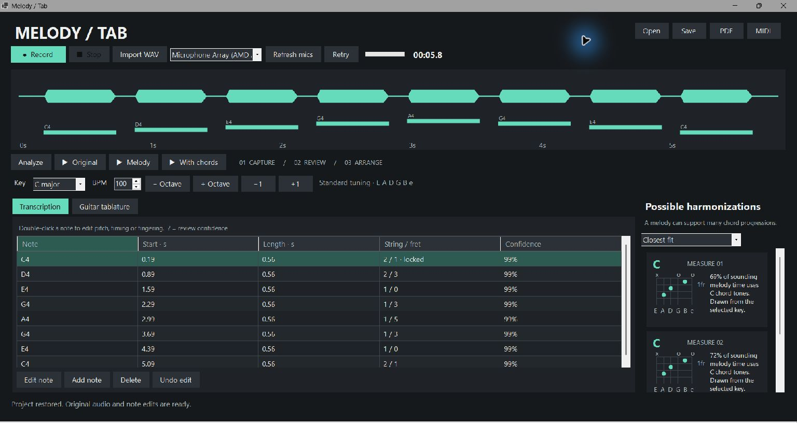
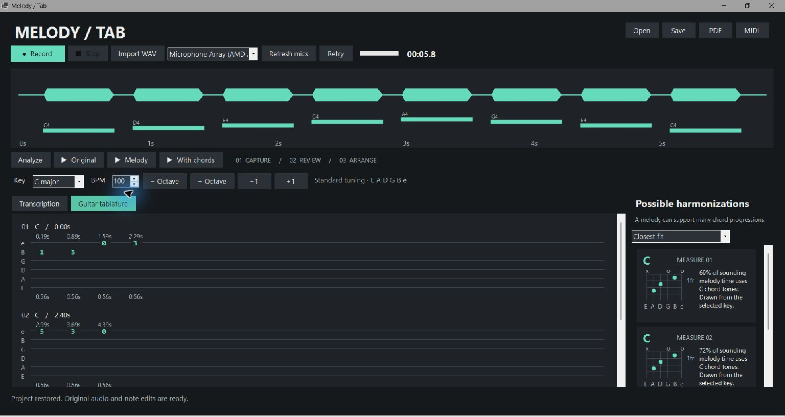
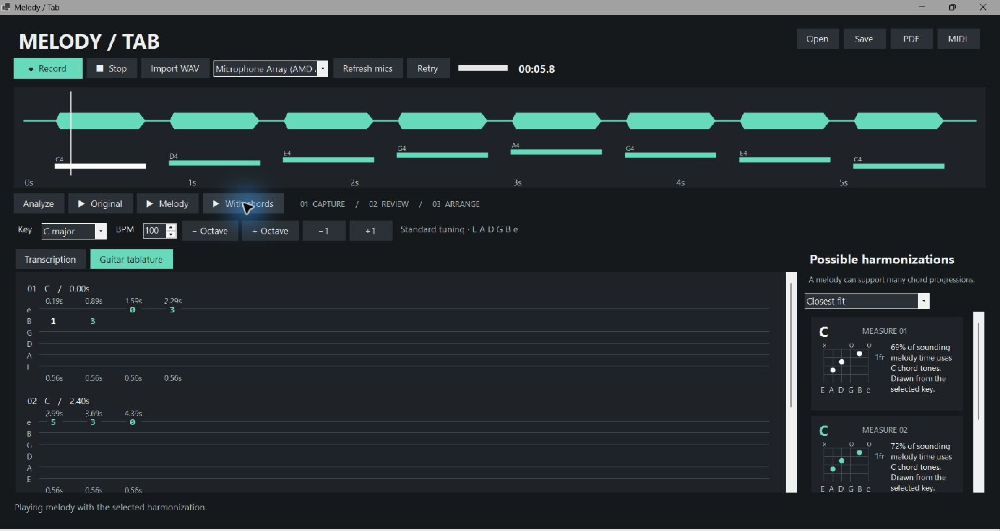
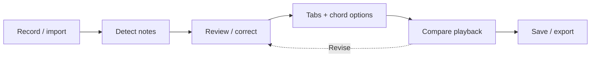
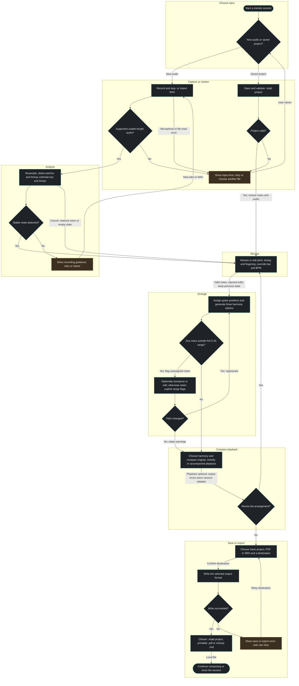

# Melody / Tab

**Hum an idea. Review the notes. Find it on the guitar.**

Melody / Tab is a local Windows desktop application that turns a short, unaccompanied hummed or sung melody into editable notes, six-string guitar tablature and suggested chord progressions. Compare your original recording with synthesized playback, explore possible harmonizations, and export your work as a printable PDF or MIDI melody.

**C# · .NET 10 · Windows Forms · NAudio 2.2.1 · Local audio processing**

> Working MVP. Clean, single-voice recordings work best. Key, rhythm and chords are estimates to review, not guaranteed musical answers. No paid API, account or cloud processing is required.



*Real screenshot of the running application using the generated eight-note reference recording. The transcription was produced by the audio analyzer; it is not a hardcoded application demo.*

[Features](#features) · [Screenshots](#screenshots) · [Workflow](#workflow) · [Setup](#run) · [User guide](#use) · [Architecture](#architecture) · [Tests](#verify) · [Limitations](#realistic-limits)

## Features

| Area | Available in this MVP |
| --- | --- |
| Capture | Select/refresh microphones; record, stop and retry; duration, input peak meter and waveform; WAV import |
| Transcription | Detect pitch, octave, onset and duration; smooth brief pitch fluctuations; highlight uncertain notes |
| Correction | Edit, add and delete notes; adjust timing; lock a valid string/fret position; undo note edits and transposition |
| Musical context | Estimate major/minor key and tempo; manually override both; 4/4 measure guide |
| Guitar tabs | Standard six-string tuning; phrase-level fingering optimization; fret 0–20 support; semitone/octave transposition; explicit out-of-range warnings |
| Harmony | Closest-fit, alternative-color and beginner open-chord suggestions; measure alignment, chord diagrams and chord-tone explanations |
| Playback | Original recording, synthesized melody or melody plus chords; current note, fret and chord highlighting |
| Projects | Save/open a portable `.mtab` archive containing audio, notes and arrangement settings |
| Exports | Paginated printable PDF with tabs/chord names; type-0 MIDI containing the melody and timing |
| Interface | Charcoal theme, restrained teal accents, custom-drawn score views, keyboard shortcuts, resizable workspace and high-DPI configuration |
| Responsiveness | Background analysis and synthesis, progress reporting and cancellation |

## Screenshots

These images are actual Windows Forms captures, not design mockups. They use the same synthetic known-pitch fixture for reproducibility; they do not demonstrate human transcription accuracy or live microphone capture.

### Review the transcription

The opening screenshot above shows pitch names, onset/duration in seconds, selected fingerings and confidence. You can compare the note timeline with the waveform before arranging.

### Read the guitar tablature



Fret numbers sit on the corresponding strings. Onset seconds appear above each event and duration seconds below; spacing is an event guide rather than engraved rhythmic notation.

### Compare playback



The white playhead and active note/fret/chord help compare the transcribed melody with the selected harmonization.

Screenshot provenance and recapture instructions: [docs/screenshots/README.md](docs/screenshots/README.md).

## Workflow

**Record or import → analyze → review/correct → arrange → compare playback → save/export.**

Opening an existing `.mtab` restores the previous recording and edits. New audio is analyzed automatically after a successful import or recording stop. Corrections regenerate tabs and chord suggestions. Transposition is a user choice: out-of-range notes stay flagged until addressed.



<details>
<summary>Expand the full workflow, including retry and correction paths</summary>



</details>

The diagram is a projection of the **EW AI Flowchart EFD 2.1** model:

- [Importable workflow model](docs/workflow/melody-to-tab.efd.json)
- [Mermaid diagram source](docs/workflow/melody-to-tab.mmd)
- [Model scope, validation and pending responsibility metadata](docs/workflow/README.md)

This describes a recommended user journey through implemented behavior, not a forced wizard. The app lets you save, export or revisit editing when the relevant data is available. Exporting a PDF does not also create MIDI or a project file. Closing and cancelling dialogs remain user choices.

## Run

Requirements: Windows 10/11 and the **.NET 10 SDK** for development, or the **.NET 10 Desktop Runtime** for the published application. A microphone is optional when importing WAV files. No Python, FFmpeg, cloud API, paid service, model download or account is required by the app.

From this directory:

```powershell
dotnet restore MelodyToTab.sln
dotnet build MelodyToTab.sln -c Release
dotnet run --project src/MelodyToTab.Desktop -c Release
```

Alternatively open `MelodyToTab.sln` in a Visual Studio version supporting .NET 10, with the .NET desktop development workload. Select `MelodyToTab.Desktop` as startup project.

The built executable is `src/MelodyToTab.Desktop/bin/Release/net10.0-windows/MelodyToTab.Desktop.exe`. If you have a locally published build, run `artifacts/app/MelodyToTab.Desktop.exe` and keep all files in that folder together. Generated `artifacts/` files are ignored by Git and are not included in a source checkout; build or publish them with the commands below. It requires the Desktop Runtime. The app also accepts a `.wav` or `.mtab` path as its first command-line argument.

Publish yourself:

```powershell
dotnet publish src/MelodyToTab.Desktop -c Release --no-self-contained -o artifacts/app
# Optional larger distribution including the runtime:
dotnet publish src/MelodyToTab.Desktop -c Release -r win-x64 --self-contained true -o artifacts/self-contained
```

NuGet restores the pinned **NAudio 2.2.1** dependency and its transitive packages on the first build. Subsequent application use is offline. [NAudio](https://github.com/naudio/NAudio) provides Windows device enumeration, WinMM capture and playback; this code intentionally uses its 2.x API. No PDF/MIDI package is needed: the limited writers here emit PDF 1.4 and standard MIDI type 0.

## Use

1. Select a microphone. Press **Record**, hum a clean phrase, then **Stop**. Recording stops at 90 seconds and automatically analyzes. **Retry** starts a new take after warning about unsaved work. **Refresh mics** picks up device changes.
2. Or choose **Import WAV**. Supported formats: PCM 8/16/24/32-bit and IEEE float 32-bit, 8–192 kHz, up to eight channels (mixed to mono), 0.2–90 seconds. Compressed WAV is rejected with a helpful message.
3. Review the waveform and transcription. Amber / `?` means confidence below 85%; this is a heuristic, not a calibrated probability. Double-click a row or use **Edit note** / Enter to change pitch, start, duration or fingering. Use sharp names with an octave, such as `F#3`. Add and delete notes; **Undo edit** restores note edits and transpositions. Notes cannot overlap.
4. Override the estimated key and BPM. The guide assumes **4/4**, with measure one at recording time zero. BPM changes measure boundaries and chord placement, **not** the recorded seconds or playback speed. Shorten leading silence by editing note starts if needed; the original waveform remains unchanged.
5. Open **Guitar tablature**. Standard tuning is E2–A2–D3–G3–B3–E4, string 1 is high E, and available frets are 0–20 (total range E2–C6). Each column is one note event, with onset seconds above and duration seconds below. Column spacing is not proportional notation. Rests are gaps between events; a note can sustain across a barline. `!` / “Transpose needed” means a note has no position. Use octave or semitone buttons to move the melody into range. Transposition never changes the original recording.
6. Choose **Closest fit**, **Alternative color**, or **Beginner · open chords**. Each card shows its measure, shape and chord-tone coverage. Diagrams run low E to high E; `x` means muted, `o` open, and `fr` labels the first displayed fret. Repeated fret dots on a barre shape may require a barre. Chords are suggestions, not unique answers; strong melody constraints can make some measures identical across alternatives.
7. Compare **Original**, **Melody**, and **With chords**. The playhead, current note, tab fret and chord card highlight during playback. **Stop** stops playback. Space toggles synthesized melody playback outside text/number/combo controls; Escape stops or cancels analysis. Ctrl+S saves.
8. Save a `.mtab` project (ZIP containing JSON metadata and embedded PCM16 WAV), and reopen it with **Open**. It preserves notes, timing, confidence, locked fingerings, key, tempo and harmony choice. Saving replaces the chosen file atomically after creating a temporary archive.
9. **PDF** exports paginated, searchable six-string tablature with chord names and exact timing. It uses a practical monospaced print layout, not standard rhythmic engraving. **MIDI** exports the melody, tempo and original timing at 480 ticks/quarter; accompaniment is not included in MIDI.

If microphone access fails, check Windows Settings → Privacy & security → Microphone → desktop app access, or import a WAV. Silence and unstable/noisy input produce an empty transcription or warnings. Clipping is flagged. No audio is uploaded.

## How the conversion works

- **Audio:** capture mono PCM16 at 22,050 Hz. Imported WAV channels are averaged. A windowed-sinc low-pass resampler prepares 16 kHz analysis audio.
- **Pitch:** a YIN-style cumulative mean normalized difference function analyzes 64 ms windows at 10 ms hops over approximately 65–1,000 Hz. Low-energy and aperiodic frames are rejected. Parabolic lag refinement improves frequency estimates; frequency is mapped to equal-tempered MIDI pitch with A4 = 440 Hz.
- **Segmentation:** a five-frame median suppresses brief pitch flicker. Runs shorter than 80 ms are dropped; tiny gaps between the same pitch are merged. Each retained note has onset, duration and periodicity/tuning-based confidence. Analysis and synthesis run on background tasks; cancellation is checked regularly.
- **Key and tempo:** duration-weighted pitch classes are compared with major/minor key profiles. Median onset intervals provide a coarse tempo estimate with half/double folding. These are deliberately editable hypotheses, particularly weak for short or unmetered phrases.
- **Tab:** dynamic programming evaluates all matching string/fret positions, penalizing fret travel, string jumps and high frets. Manual positions are constraints. Out-of-range notes remain unassigned rather than silently changing octave.
- **Harmony:** melody overlap within each measure weights chord-tone coverage. Candidates are major/minor triads from the selected key, excluding diminished chords. A second option penalizes the first option’s choices; beginner mode uses common open chords and can borrow outside the key. The per-measure explanation reports the actual overlap score.
- **Playback:** additive tones with short attack/release envelopes synthesize the melody. Decaying, slightly staggered tones produce a simple chord accompaniment. Peak limiting prevents clipping. This is a comparison aid, not a sampled guitar instrument.

## Architecture

The application has two production projects and a standalone verification executable. UI event handling is kept in the desktop project; signal processing, musical reasoning, persistence and exports live in the core project.

| Component | Responsibility | Main files |
| --- | --- | --- |
| Presentation | Workflow, dark native controls, drawing and note correction | `MainForm.cs`, `Theme.cs`, `ScoreViews.cs`, `NoteEditor.cs` |
| Windows audio | Microphone enumeration, capture buffers, playback and device disposal | `AudioService.cs` |
| Audio/analysis | WAV decoding, resampling, pitch frames, note segmentation, key/tempo estimates | `WavCodec.cs`, `PitchAnalyzer.cs` |
| Musical arrangement | Validated notes, dynamic-programming fingering, chord scoring and shapes | `Models.cs`, `GuitarArranger.cs` |
| Synthesis | Melody tone generation and decaying chord accompaniment | `Synthesizer.cs` |
| Persistence/export | Project ZIP/JSON, embedded WAV, MIDI events and printable PDF | `ProjectStore.cs`, `Exporters.cs` |
| Verification | Reproducible audio fixtures and assertions against production code | `tests/MelodyToTab.Checks/Program.cs` |

Windows Forms provides a native desktop UI without a browser runtime. NAudio handles Windows devices; the custom local analyzer keeps the MVP independent of Python, model servers and paid APIs. The PDF and MIDI writers deliberately support only the formats described here. Analysis and synthesis run away from the UI thread; drawing and view updates stay on it.

### Files and persistence

| File | Purpose | Included content |
| --- | --- | --- |
| `.wav` | Audio input | Unaccompanied recording; supported PCM or float samples |
| `.mtab` | Reopenable project | `project.json` and optional `recording.wav` inside ZIP |
| `.pdf` | Printable arrangement | Six tab strings, suggested chord names and exact timing; diagrams remain in the app |
| `.mid` | DAW interchange | Melody note-on/off events, tempo and 4/4 metadata; no chord accompaniment |
| `.efd.json` | Workflow documentation | EFD stages, functional lanes, process graph and editor layout |

Project metadata stores format version, title, notes, confidence, timing, MIDI pitch, assigned and locked fingering, tempo, key/mode and selected harmony. Embedded audio is mono PCM16; original stereo channels and higher bit depth are not preserved. The app does not upload recordings or require sign-in.

## Project structure

```text
MelodyToTab/
  MelodyToTab.sln
  Directory.Build.props                 nullable, implicit usings, warnings as errors
  README.md
  GITHUB_DESCRIPTION.txt                paste into the GitHub About description
  docs/
    screenshots/                       real app captures and provenance
    workflow/                          EFD model, Mermaid source and validation
  licenses/NAudio-MIT.txt               dependency license
  VALIDATION.md                         observed results and manual checklist
  DESIGN.md                             visual choices and accessibility
  THIRD_PARTY_NOTICES.md
  src/
    MelodyToTab.Core/
      MelodyToTab.Core.csproj
      Models.cs                         audio, note, session and chord models; validation
      WavCodec.cs                       bounded WAV import/export
      PitchAnalyzer.cs                  resampling, pitch tracking, segmentation, key/tempo
      GuitarArranger.cs                  fingering optimization and harmony scoring
      Synthesizer.cs                     local melody and chord synthesis
      ProjectStore.cs                    portable project archives
      Exporters.cs                       text tab, PDF and MIDI writers
    MelodyToTab.Desktop/
      MelodyToTab.Desktop.csproj
      Program.cs                        DPI-aware Windows Forms entry point
      MainForm.cs                       workflow and asynchronous orchestration
      AudioService.cs                   NAudio capture/playback and device lifecycle
      Theme.cs                          colors and native control styles
      ScoreViews.cs                     custom waveform, tab and chord drawing
      NoteEditor.cs                     keyboard-accessible correction dialog
  tests/
    MelodyToTab.Checks/
      MelodyToTab.Checks.csproj
      Program.cs                        deterministic executable regression checks
  artifacts/                            ignored build/test/distribution outputs
```

## Verify

```powershell
dotnet run --project tests/MelodyToTab.Checks -c Release -- artifacts
# Optional additional real recordings; they must meet the same WAV constraints:
dotnet run --project tests/MelodyToTab.Checks -c Release -- artifacts C:\Audio\hum1.wav C:\Audio\hum2.wav
```

The checks generate real audio, run the production analyzer, inspect exported MIDI events, validate fingerings, exercise project round trips and write reviewable WAV/PDF/MIDI/project artifacts. No hardcoded transcription results are used by the application. The known-pitch arrays exist only in the test fixture generator.

### Recorded verification results

The last code validation passed **48 deterministic checks**, plus **two human-recording workflow checks**. All eight pitches in the clean reference sequence were recovered. The synthetic vocal-like fixture retained eight notes despite harmonics, modest vibrato and low additive noise. Silence and seeded white noise produced no notes.

Two public eight-second human humming/singing samples completed the pipeline and produced 23 and 21 retained notes. These are workflow checks, **not accuracy benchmarks**: aligned ground-truth labels and listening adjudication were not available. The sample audio is not shipped with the app or documentation.

The native app was visually inspected with a loaded project, tab view and accompanied playback highlighting. The PDF was rendered for inspection; exported MIDI events and project round trips were checked programmatically. A clean Release build completed with zero warnings and errors. See [VALIDATION.md](VALIDATION.md) for exact fixtures, provenance, results and the outstanding manual checklist.

## Realistic limits

This MVP expects one isolated voice. Instruments, room noise, breathiness, strong vibrato, slides, consonants, low gain and octave-rich timbres can cause missing, fragmented or octave-wrong notes. Repeated notes without a pause may merge. Notes shorter than 80 ms are generally removed. There is no source separation, learned voice model, automatic beat tracking, pickup detection, time-signature detection, quantized notation, alternate tuning, capo support or guitar technique inference.

Key and tempo are ambiguous, especially for short melodies. Chord rankings do not model full voice leading or musical style. A 20-fret limit can reject pitches playable on a 24-fret instrument. Exports preserve detected timing rather than pretending expressive singing has a definite rhythm. Native file dialogs and some Windows scrollbar/number controls retain operating-system styling. See `VALIDATION.md` for exactly what was tested and what still needs manual testing.

## Keyboard controls

| Shortcut / action | Behavior |
| --- | --- |
| Ctrl+S | Save the project when not recording or analyzing |
| Escape | Stop playback/recording or cancel analysis |
| Space | Toggle synthesized melody playback outside text, number and combo inputs |
| Enter on a note row | Open the note editor |
| Delete on a note row | Delete the selected note; Undo edit restores it |
| Tab / Shift+Tab | Move through native focusable controls |
| Alt plus an underlined button mnemonic | Activate the corresponding command |

## Troubleshooting

| Symptom | What to try |
| --- | --- |
| App asks for .NET | Install the .NET 10 **Desktop Runtime**, or publish a self-contained build. The basic .NET runtime alone does not include Windows Forms. |
| Build cannot find the SDK | Install the .NET 10 SDK and run `dotnet --info`; use a compatible Visual Studio version for IDE builds. |
| No microphone listed | Connect a device and use Refresh mics. WAV import works without a microphone. |
| Recording cannot start | Check desktop microphone access in Windows privacy settings, confirm the device is connected, and close competing capture apps. |
| Empty transcription | Hum one sustained note at a time, reduce background noise, increase input level and record a longer phrase. |
| Excess notes or wrong octaves | Avoid instruments/echo, reduce slides and wide vibrato, then edit or delete uncertain detections. |
| Recording clips | Reduce microphone gain or increase distance; clipping can distort pitch estimates. |
| Notes cannot be fingered | Transpose or edit pitches into E2–C6 for the configured 20-fret guitar. |
| Chords sound unexpected | Review the key and BPM, compare alternatives, and remember that a melody does not imply one unique progression. |
| PDF rhythm looks different from sheet music | The MVP exports onset/duration guides, not quantized standard notation. |
| Save/export fails | Choose a writable destination and close an application holding the output file. |

Microphone permission denial, unplugging during capture, long-session stability, listening quality, screen readers and mixed-DPI resizing still require broader manual validation. High-DPI support is configured; accessibility conformance is not certified.

## Documentation and repository metadata

- [GitHub description](GITHUB_DESCRIPTION.txt): copy the one-line text into the repository's About description.
- Suggested topics: `csharp`, `dotnet`, `winforms`, `windows`, `audio-processing`, `pitch-detection`, `guitar-tablature`, `music-transcription`, `midi`, `naudio`.
- [Design decisions](DESIGN.md): hierarchy, color palette, typography and accessibility approach.
- [Validation record](VALIDATION.md): measured checks and remaining manual work.
- [Third-party notices](THIRD_PARTY_NOTICES.md): dependency and validation-data attribution.
- [Workflow model notes](docs/workflow/README.md): EFD scope and validation.

Documentation images live under `docs/` so they are included in GitHub source checkouts. Build outputs, temporary fixtures, personal recordings and `.mtab` files remain ignored. No GitHub release, CI status, hosted download or public repository URL is claimed by this README.

## Licensing

No project-wide license has been selected yet. The bundled [NAudio MIT license](licenses/NAudio-MIT.txt) applies to that dependency, not automatically to this application's source. See [THIRD_PARTY_NOTICES.md](THIRD_PARTY_NOTICES.md) for details. Third-party human recordings used in validation are excluded from the distribution; the documentation screenshots use only generated reference audio.
